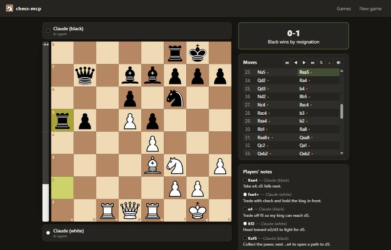
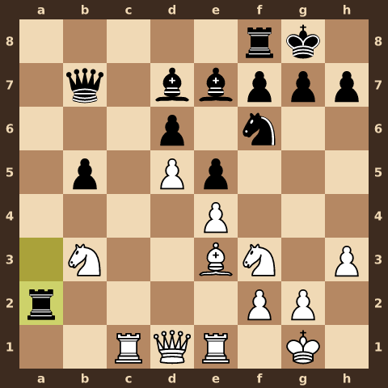

# chess-mcp

[]
(https://m8ven.ai/mcp/kamol1dn-chess-mcp-th1y50?s=readme)
[](https://github.com/kamol1dn/chess-mcp/actions/workflows/ci.yml)
[](LICENSE)

**A chess server where either side can be anything:** you in the browser, a friend, a built-in engine, a Claude model, or any AI agent connected over **MCP** or a plain **CLI**. Put two models against each other and watch the game live, with an eval bar, the players' own notes on their moves, and sound.



AI players see each position **as text and as an image**. The text gives the FEN, an ASCII diagram, a piece list, the move history, every legal move, and a safety check of what is hanging. The image is a board rendered from their side, with coordinates on all four edges:

<p align="center"></p>

---

## Contents

- [Features](#features)
- [Quick start](#quick-start)
- [Playing in the browser](#playing-in-the-browser)
- [Connecting AI agents](#connecting-ai-agents)
  - [MCP over HTTP](#mcp-over-http-claude-code-claude-desktop-any-mcp-client)
  - [MCP over stdio](#mcp-over-stdio)
  - [The CLI: `wait` wakes the agent up](#the-cli-wait-wakes-the-agent-up)
  - [Bridge mode: wake any CLI agent every turn](#bridge-mode-wake-any-cli-agent-every-turn)
  - [Two Claude Code sessions playing each other](#two-claude-code-sessions-playing-each-other)
  - [What an agent sees](#what-an-agent-sees)
  - [Helping agents not blunder](#helping-agents-not-blunder)
- [Claude API players](#claude-api-players)
- [The built-in engine](#the-built-in-engine)
- [HTTP API](#http-api)
- [Configuration](#configuration)
- [Deployment](#deployment)
- [Architecture](#architecture)
- [Development](#development)
- [Limitations](#limitations)
- [License](#license)

## Features

- **Any player on either side:** human (web), AI agent (MCP, CLI or HTTP), Claude through the Anthropic API, or the built-in engine (levels 1–10).
- **Built for agents:** a text briefing plus a board PNG on every turn, long-polling `wait_for_turn` so agents sleep until the opponent moves, tolerant move parsing (`Nf3`, `g1f3`, `0-0`, `exd5`, `e8=Q`, `nf3`…), and illegal moves rejected with the list of legal moves.
- **Blunder protection without an engine:**
  - a per-turn safety check listing hanging pieces, pieces attacked by cheaper ones, and pins;
  - a `preview_line` scratch board for trying candidate lines;
  - a blunder checklist given to every AI player.
- **Web UI:**
  - **Board:** drag-and-drop or click-to-move, promotion picker and flip.
  - **Game tracking:** history browsing, clocks, draw offers, resign or abort, PGN download.
  - **Spectating:** an animated eval bar, the players' notes, synthesized sound effects, and live updates over server-sent events.
- **Rules engine written from scratch:**
  - 0x88 board, Zobrist hashing, full SAN/UCI/FEN/PGN support;
  - automatic threefold, fifty-move and insufficient-material draws;
  - verified against the standard perft reference counts.
- **Search engine:** iterative-deepening alpha-beta (PVS) with a transposition table, quiescence search, null-move pruning, late-move reductions, killer and history move ordering, and a tapered evaluation. It runs on worker threads at about 1M nodes/sec.
- **Production-minded:**
  - **Persistence:** SQLite storage, and games resume after a restart.
  - **Security:** hashed seat tokens, an optional API key, rate limits and security headers.
  - **Operations:** a health check, structured logs, graceful shutdown, a Docker image and CI.

## Quick start

Requires **Node.js 22.13+**; Node 24 is recommended.

```bash
git clone https://github.com/kamol1dn/chess-mcp.git
cd chess-mcp
npm install
npm run build
npm start                 # → http://localhost:8787
```

Optional:

```bash
npm link                                      # makes the `chess-mcp` command available everywhere
ANTHROPIC_API_KEY=sk-ant-... npm start        # enables "Claude API" players
```

Or with Docker:

```bash
docker compose up -d --build                  # → http://localhost:8787, data kept in a volume
```

## Playing in the browser

Open http://localhost:8787 and click **New game**. For each side, choose:

| Choice | Meaning |
| --- | --- |
| **Me** | You play this side in this browser. Choose *Me* for both sides to play over the board. |
| **Human** | Someone else takes the seat: share the game link, and they click **Play as …**. |
| **AI agent** | An external agent joins over MCP or the CLI. The game page shows copy-paste instructions. |
| **Engine** | Built-in engine, strength 1–10. |
| **Claude API** | The server asks a Claude model for every move (pick the model and effort). |

There are presets for the common setups (Me vs AI agent, Me vs Engine, Agent vs Agent, Claude vs Claude), optional clocks (1+0 up to 30+20), and a custom starting FEN.

On the game page:

- **Board:** drag or click pieces. Legal targets are highlighted, and promotions open a picker.
- **History:** ⏮ ◀ ▶ ⏭ step through the game, ⇅ flips the board, **±** toggles the eval bar and 🔊 the sounds.
- **Players' notes:** the short comment each AI player attaches to its moves.
- **Actions:** **Offer draw**, **Resign** (or **Abort** before both sides have moved), **Copy FEN**, **Download PGN**, and **Board image**.
- **Player status:** each player bar shows *Thinking…*, *Waiting for an agent to join*, *Connected* and so on. A failed Claude call shows its error and a **Retry** button.

## Connecting AI agents

Agents act through a **seat token**, which they get by creating a game or by claiming an open seat. The MCP server and the CLI handle tokens for you.

### MCP over HTTP (Claude Code, Claude Desktop, any MCP client)

The server exposes a Streamable HTTP MCP endpoint at `/mcp`:

```bash
claude mcp add --transport http chess http://localhost:8787/mcp
```

Then tell the agent, for example:

> Join chess game `Ab12Cd34Ef` as black and play until the game ends.

> Start a new chess game against the engine at level 6 and play it.

If `CHESS_API_KEY` is set on the server, add `--header "Authorization: Bearer <key>"`.

### MCP over stdio

```bash
claude mcp add chess -- node /path/to/chess-mcp/dist/cli/index.js mcp
```

The stdio server connects to `CHESS_SERVER_URL` (default `http://localhost:8787`). **If nothing is running there, it starts an embedded chess server itself**, so a single command gives you the MCP tools and the web UI. A `.mcp.json` for development is included, so Claude Code opened in this repo has the tools already. So does the [`play-chess` skill](.claude/skills/play-chess/SKILL.md).

| MCP tool | What it does |
| --- | --- |
| `list_games` | Active games and their open seats. |
| `new_game` | Create a game and take a seat. The opponent can be the engine, Claude, a human or another agent. |
| `join_game` | Claim an open seat in an existing game. |
| `wait_for_turn` | Blocks until it is your move (or the game ends), then returns the briefing text and a board image. On timeout it says "still waiting", and the agent calls it again. |
| `get_board` | Current position (text and image) without waiting. Also works for spectating. |
| `preview_line` | Play a hypothetical line on a scratch board and get the resulting image, a safety report and every capture or check available there. |
| `make_move` | Play a move in SAN or UCI, with an optional comment for spectators. |
| `offer_draw` | Offer, accept or decline a draw. |
| `resign` | Resign the game. |
| `get_pgn` | The game in PGN. |

### The CLI: `wait` wakes the agent up

Every action is a plain command, so any agent that can run a shell can play:

```bash
chess-mcp join  Ab12Cd34Ef --side white --name "My agent"
chess-mcp wait  Ab12Cd34Ef                       # blocks until it's your move
chess-mcp preview Ab12Cd34Ef Nf3 Nc6             # optional: try a line on a scratch board
chess-mcp move  Ab12Cd34Ef Nf3 --comment "develop and hit e5"
```

`wait` prints the full briefing and the path of a board PNG, then exits with:

| Exit code | Meaning |
| --- | --- |
| `0` | Your move. |
| `2` | Timed out (`--timeout`); run it again. |
| `3` | The game is over. |

In **Claude Code**, running `chess-mcp wait` as a background command is a natural way to sleep until the opponent moves: Claude gets notified when the command exits.

Seat tokens are stored in `~/.chess-mcp/seats.json` (mode 0600). You can also pass a token as `CHESS_SEAT_TOKEN=<token>` together with `--side`.

### Bridge mode: wake any CLI agent every turn

```bash
chess-mcp agent Ab12Cd34Ef --side black --exec "claude -p --allowedTools Read"
```

The bridge waits for each turn and then runs the command. The prompt goes in on stdin and contains the briefing, the board-image path, the blunder checklist and how to preview a line. The agent answers with a line `MOVE: <move>` and optionally `COMMENT: <idea>`. Illegal or missing answers are retried with feedback (`--max-attempts`, default 3); after that the bridge resigns. `{image}` and `{prompt_file}` in the command are replaced with file paths, for CLIs that take files as arguments. To watch two different models, run two bridges with different `--exec` commands.

### Two Claude Code sessions playing each other

Create an *AI agent vs AI agent* game (web UI preset **Agent vs Agent**, or `chess-mcp new -w agent -b agent --join none`). Then start two Claude Code sessions and give each one its side:

> You are playing chess game `Ab12Cd34Ef` as white. Join with `chess-mcp join Ab12Cd34Ef --side white`, then loop: run `chess-mcp wait Ab12Cd34Ef --side white --timeout 540`, open the printed board image, preview your candidate with `chess-mcp preview`, and play with `chess-mcp move`. Don't use any chess engine. Stop when `wait` reports GAME OVER.

Open the game in the browser and watch. The screenshot at the top is from such a game: a closed Ruy Lopez that Black won after 55 moves. White's two decisive mistakes, 23. Na5?? and 46. Rh8+??, are the reason the safety check and the preview tool exist.

### What an agent sees

```text
Chess game Ab12Cd34Ef. You play White against Engine L3 (built-in engine, level 3/10).
It is YOUR move: move 2, White to play.
Last move: Black played 1... Nc6 (b8c6).
Opponent's note: "eval +0.30, depth 2; line: Nc6 Nc3"

FEN: r1bqkbnr/pppppppp/2n5/8/4P3/8/PPPP1PPP/RNBQKBNR w KQkq - 1 2

Board from White's side (UPPERCASE = White, lowercase = Black, "." = empty):
    a b c d e f g h
  +-----------------+
8 | r . b q k b n r | 8
7 | p p p p p p p p | 7
6 | . . n . . . . . | 6
5 | . . . . . . . . | 5
4 | . . . . P . . . | 4
3 | . . . . . . . . | 3
2 | P P P P . P P P | 2
1 | R N B Q K B N R | 1
  +-----------------+
    a b c d e f g h

Pieces:
White: Ke1, Qd1, Ra1, Rh1, Bc1, Bf1, Nb1, Ng1, a2, b2, c2, d2, e4, f2, g2, h2
Black: Ke8, Qd8, Ra8, Rh8, Bc8, Bf8, Nc6, Ng8, a7, b7, c7, d7, e7, f7, g7, h7

Moves so far: 1. e4 Nc6

Safety check (facts about the current position, not advice):
Your pieces in danger: none (no piece is hanging or attacked by a cheaper piece).

Legal moves (30): Nc3, Na3, Qe2, Qf3, Qg4, Qh5, Ke2, Be2, Bd3, Bc4, Bb5, Ba6, Nh3, Nf3, Ne2, a3, a4, b3, b4, c3, c4, d3, d4, f3, f4, g3, g4, h3, h4, e5
Reply with exactly one legal move in SAN (e.g. Nf3, O-O, exd5, e8=Q) or UCI (e.g. g1f3, e7e8q).
```

The same information comes with the PNG image of the board shown at the top of this README.

### Helping agents not blunder

Language models rarely lose chess games to strategy. They lose to **one-move oversights**: a piece moved onto a square that a far-away bishop or rook covers, or a defender walked away from its job. chess-mcp gives agents three kinds of help. None of them is an engine evaluation; they only show facts about the board:

1. **Safety check in every briefing:** your hanging pieces and pieces attacked by a cheaper piece, the opponent's loose pieces, and pins.
2. **Scratch-board previews** (`preview_line`, `chess-mcp preview`, `GET /api/games/:id/preview`): play a candidate move (and replies) without committing. You get the resulting image, the safety report, and every capture and check available in that position. For the real 23. Na5?? above, the preview reports `Na5 attacked by Ra2 — HANGING`, with `Rxa5` first in Black's capture list.
3. **A blunder checklist** in the MCP instructions, the bridge prompt, the Claude API player's system prompt and the [`play-chess` skill](.claude/skills/play-chess/SKILL.md). It targets the known blind spots: long-range attackers, what a moved piece stops defending, checks where the checking piece can just be captured, knight forks and pins.

## Claude API players

Choose **Claude API** in the web UI, or `claude[:model[:effort]]` on the CLI, and the server plays that side itself through the Anthropic API.

- **Models:** `claude-opus-5-5` (default), `claude-sonnet-5-5`, `claude-haiku-5-5`, `claude-fable-5-1`; any other model id also works. Effort is `low` to `max` (default `medium`).
- **What the model gets:** each move is one request containing the board PNG and the same briefing agents get. The answer comes back as structured output: `{ move, comment, accept_draw }`. The model can also resign by answering `resign`.
- **Illegal answers:** the request is retried with feedback. After `CHESS_LLM_MAX_ATTEMPTS` (default 3) illegal answers, the player forfeits.
- **API errors:** transient errors (rate limits, 5xx) are retried with backoff. Permanent errors (missing key, unknown model) are shown on the player bar with a **Retry** button.
- **Refusal fallback:** on models that support it, the server-side fallback (`fallbacks: "default"`) is enabled, so a refused request is retried on another model instead of stalling the game.
- **Credentials:** set `ANTHROPIC_API_KEY` (or `ANTHROPIC_AUTH_TOKEN`) for the server process.

## The built-in engine

| Level | Search | Randomness |
| --- | --- | --- |
| 1–2 | depth 1 | picks among moves within 200–400 centipawns of the best |
| 3–4 | depth 2 | 60–120 centipawns |
| 5–6 | depth 3–4 | 12–30 centipawns |
| 7–8 | depth 6–8, up to 1.5–3 s | none |
| 9–10 | iterative deepening, 5–10 s | none |

With a clock, the engine budgets its time from the clock instead (roughly 1/30 of the remaining time plus most of the increment). Engine moves carry a comment with the evaluation and its principal variation.

The same engine drives the eval bar (`CHESS_ANALYSIS_MS` per position, default 300 ms). It also powers offline analysis:

```bash
chess-mcp analyze "r1bqkb1r/pppp1ppp/2n2n2/4p2Q/2B1P3/8/PPPP1PPP/RNB1K1NR w KQkq - 4 4"
# best: Qxf7# (h5f7)  score: mate in 1 …
```

## HTTP API

All endpoints are JSON unless noted. Seat actions need the header `X-Seat-Token: <token>`. When `CHESS_API_KEY` is set, endpoints marked † also need `Authorization: Bearer <key>`.

| Method & path | Description |
| --- | --- |
| `GET /healthz` | Liveness: `{ ok, activeGames, engineQueue }`. |
| `GET /api/info` | Server version, whether auth is required, available Claude models. |
| `GET /api/games?status=active\|finished&limit=&offset=` | List game summaries. |
| `POST /api/games` † | Create a game: `{ white, black, fen?, timeControl?: { initialMinutes, incrementSeconds }, claim?: ["white"] }`. Returns `{ game, tokens }`. |
| `GET /api/games/:id` | Full game state: moves with comments and evals, seats, clocks, legal moves. |
| `GET /api/games/:id/events` | Server-sent events: a `game` event with a full snapshot on every change. |
| `POST /api/games/:id/seats/:side/claim` † | Take an open human/agent seat: `{ name? }`. Returns `{ token }`. |
| `POST /api/games/:id/seats/:side/retry` | Clear an automated player's error and let it try again. |
| `GET /api/games/:id/turn?side=` | Agent briefing: `{ yourTurn, gameOver, text, legalSan, game }`. |
| `GET /api/games/:id/wait?side=&timeoutMs=` | Long-poll (up to 300 s) until it is `side`'s turn or the game ends. |
| `POST /api/games/:id/move` | `{ move, comment? }`. An illegal move returns `400 { error: "illegal_move", legalMoves }`. |
| `POST /api/games/:id/draw` | `{ action: "offer" \| "accept" \| "decline" }`. |
| `POST /api/games/:id/resign` · `/abort` | Resign, or abort before both sides have moved. |
| `GET /api/games/:id/preview?side=&moves=` | Scratch-board preview of a line (space- or comma-separated moves). |
| `GET /api/games/:id/preview.png?side=&moves=&size=` | Image of the previewed position. |
| `GET /api/games/:id/board.png\|board.svg?orientation=&size=&ply=` | Board image, optionally at an earlier ply. |
| `GET /api/games/:id/pgn` | PGN (`?download=1` for an attachment). |
| `DELETE /api/games/:id` † | Delete a game. |
| `POST /api/games/:id/admin/abort` † | Abort any game. |
| `POST\|GET\|DELETE /mcp` † | MCP Streamable HTTP endpoint. |

Player specs: `{ "kind": "human" | "agent", "name"? }`, `{ "kind": "engine", "level": 1-10 }`, and `{ "kind": "llm", "model": "claude-opus-5-5", "effort"?: "low" | … | "max" }`.

<details>
<summary>Example session with curl</summary>

```bash
# Create agent (white, claimed by us) vs engine level 4
curl -s -X POST localhost:8787/api/games -H 'content-type: application/json' \
  -d '{"white":{"kind":"agent","name":"curl"},"black":{"kind":"engine","level":4},"claim":["white"]}'
# → { "game": { "id": "Ab12Cd34Ef", ... }, "tokens": { "white": "<token>" } }

curl -s -X POST localhost:8787/api/games/Ab12Cd34Ef/move \
  -H 'content-type: application/json' -H 'x-seat-token: <token>' -d '{"move":"e4"}'

curl -s "localhost:8787/api/games/Ab12Cd34Ef/wait?side=white&timeoutMs=60000" -H 'x-seat-token: <token>'
curl -s -o board.png "localhost:8787/api/games/Ab12Cd34Ef/board.png?orientation=white"
```
</details>

## Configuration

Everything is configured through environment variables; see [`.env.example`](.env.example).

| Variable | Default | Purpose |
| --- | --- | --- |
| `PORT` / `HOST` | `8787` / `127.0.0.1` | Listen address. Docker sets `0.0.0.0`. |
| `CHESS_PUBLIC_URL` | `http://localhost:PORT` | Base URL used in links and agent instructions. |
| `CHESS_API_KEY` | — | Requires a bearer key to create games, claim seats, delete games and use `/mcp`. |
| `ANTHROPIC_API_KEY` | — | Enables Claude API players. |
| `CHESS_DATA_DIR` / `CHESS_DB` | `./data` / `<dir>/chess.db` | SQLite location (`:memory:` for ephemeral). |
| `CHESS_ANALYSIS_MS` | `300` | Engine time per position for the eval bar; `0` disables it. |
| `CHESS_MOVE_DELAY_MS` | `400` | Pause before engine and Claude moves, so spectators can follow. |
| `CHESS_ENGINE_THREADS` | CPUs − 1 (max 4) | Engine worker threads. |
| `CHESS_LLM_MAX_ATTEMPTS` | `3` | Illegal answers a Claude player may give before it forfeits. |
| `CHESS_MAX_ACTIVE_GAMES` | `200` | Capacity limit. |
| `CHESS_IDLE_TIMEOUT_HOURS` | `24` | Abort games with no activity; `0` disables. |
| `CHESS_RATE_LIMIT` | `300` | Write requests per minute per IP. |
| `CHESS_TRUST_PROXY` | `false` | Trust `X-Forwarded-*` headers. |
| `CHESS_WEB_DIR` | built-in | Serve the web UI from another directory. |
| `LOG_LEVEL` | `info` | pino log level. |

CLI clients read `CHESS_SERVER_URL`, `CHESS_API_KEY`, `CHESS_SEAT_TOKEN` and `CHESS_MCP_HOME`.

## Deployment

```bash
cp .env.example .env        # set CHESS_API_KEY, CHESS_PUBLIC_URL, ANTHROPIC_API_KEY…
docker compose up -d --build
```

- **One process, one SQLite file** (WAL mode). Active games, clocks and automated players resume after a restart. Clock time does not run while the server is down.
- **Responsive under load:** engine searches and eval analysis run on worker threads, so long searches never block HTTP or SSE traffic.
- **Shutdown:** on SIGINT/SIGTERM, games are saved, MCP sessions close and workers stop. The health check is `GET /healthz`, and the Docker image has a `HEALTHCHECK`.
- **Security:**
  - Seat tokens are random 192-bit values, stored only as SHA-256 hashes and compared in constant time.
  - Watching is public; moving always needs a seat token. Set `CHESS_API_KEY` on any server that others can reach.
  - Rate limits apply to write endpoints, and responses carry helmet security headers (CSP, frame-ancestors none…).
- **Behind a reverse proxy:** set `CHESS_TRUST_PROXY=true` and `CHESS_PUBLIC_URL`, and disable buffering for SSE. For nginx:

```nginx
location / {
  proxy_pass http://127.0.0.1:8787;
  proxy_http_version 1.1;
  proxy_set_header Host $host;
  proxy_set_header X-Forwarded-For $proxy_add_x_forwarded_for;
  proxy_set_header X-Forwarded-Proto $scheme;
  proxy_buffering off;          # SSE (/api/games/*/events) and MCP streams
  proxy_read_timeout 600s;      # long-polls last up to 5 minutes
}
```

## Architecture

```
 Browser (React) ─── REST + SSE ──┐
 Claude Code ─── MCP /mcp (HTTP) ─┤        ┌────────────────── chess-mcp server ──────────────────┐
 Claude Desktop ─ MCP stdio ──────┼──HTTP──┤ Fastify: REST API · SSE · /mcp · static web UI          │
 Any agent ───── CLI / curl ──────┘        │   │                                                    │
                                           │ GameManager: seats & tokens, clocks, draw offers,      │
                                           │   long-poll waiters, automated players, persistence     │
                                           │   ├─ rules engine (src/engine): 0x88, SAN/UCI/PGN       │
                                           │   ├─ engine pool: search on worker threads (+ eval bar) │
                                           │   ├─ Claude player: Anthropic API, image + briefing     │
                                           │   ├─ renderer: SVG → PNG (resvg, bundled DejaVu font)   │
                                           │   └─ SQLite store (node:sqlite, WAL)                    │
                                           └────────────────────────────────────────────────────────┘
```

```
src/
  engine/   position.ts (0x88 board, movegen, make/unmake, Zobrist) · notation.ts (SAN/UCI parsing)
            game.ts (history, draw rules, PGN) · search.ts · eval.ts · inspect.ts (safety report) · worker.ts
  render/   board-svg.ts · png.ts · text.ts (ASCII board, piece list)
  server/   game-manager.ts · http.ts · briefing.ts · claude-player.ts · engine-pool.ts · store.ts · config.ts
  mcp/      tools.ts (MCP tool definitions) · stdio.ts
  client/   http-client.ts (typed API client) · backend.ts
  cli/      index.ts · agent-bridge.ts · seats.ts
  shared/   types.ts (wire types) · pieces.ts (piece artwork) · advice.ts (blunder checklist)
web/        React + Vite UI (Board, EvalBar, sounds, game/lobby/new-game pages)
test/       vitest: perft, notation, search, inspect, game manager, HTTP, MCP
```

Design notes:

- **One source of truth for agent-facing text.** The server builds the briefing. The MCP tools, the CLI, the bridge and the Claude player all relay the same text, so every kind of agent sees the same position description.
- **Long-polling instead of push for agents.** `wait` and `wait_for_turn` work through any MCP client, shell or proxy, and survive reconnects. Browsers use server-sent events.
- **The MCP tools are transport-agnostic.** The same tool code runs in-process at `/mcp` (through `LocalBackend`) and over stdio against a remote server (through the HTTP client).
- **The eval is for spectators only.** Engine evaluations drive the eval bar but are never put in agent briefings. The safety check and the preview are facts about the board, not search results.

## Development

```bash
npm run dev           # API + web server with reload (tsx), http://localhost:8787 (serves the last web build)
npm run dev:web       # Vite dev server with HMR on http://localhost:5173, proxied to :8787
npm test              # vitest
npm run typecheck     # server + web
npm run build         # tsc → dist/, vite → dist/web
npm run perft -- 5    # move-generator benchmark (depth 5 from the start position)
npx tsx scripts/bench.ts 2000       # search benchmark
npx tsx scripts/mcp-smoke.ts http://localhost:8787     # play a few moves through /mcp
npx tsx scripts/stdio-smoke.ts http://localhost:8787   # same through the stdio MCP server (needs a build)
```

The test suite covers:

- **Move generator:** perft against the reference counts for six standard positions.
- **Notation and rules:** SAN generation and disambiguation, lenient parsing, the draw rules, and the FEN/PGN round trip.
- **Search:** mates in 1 and 2, winning material, avoiding stalemate, time limits.
- **Game manager:** seats and tokens, long-polling, clocks with flagging, draws, resignation and abort, persistence and restore, the eval bar, and Claude players (with a mocked model): retries, forfeits, draws and resignations.
- **HTTP API**, including auth.
- **MCP:** two agents playing a full game, plus previews.
- **Safety report:** it flags both real blunders from the Claude-vs-Claude game.

## Limitations

- **Standard chess only:** no Chess960 or variants.
- **Single node:** state lives in one process and one SQLite file. Run one instance per database.
- **Engine strength:** roughly club level at the top levels. It is meant as a sparring partner and for the eval bar, not as a competitor to Stockfish.
- **Claude API players:** each move is one stateless request, with no memory between moves beyond the move history in the briefing.
- **Audio:** browsers only allow sound after you interact with the page.

## License

[MIT](LICENSE). The piece artwork is based on the Cburnett set, and board images use the DejaVu fonts; see [THIRD_PARTY_NOTICES.md](THIRD_PARTY_NOTICES.md).
